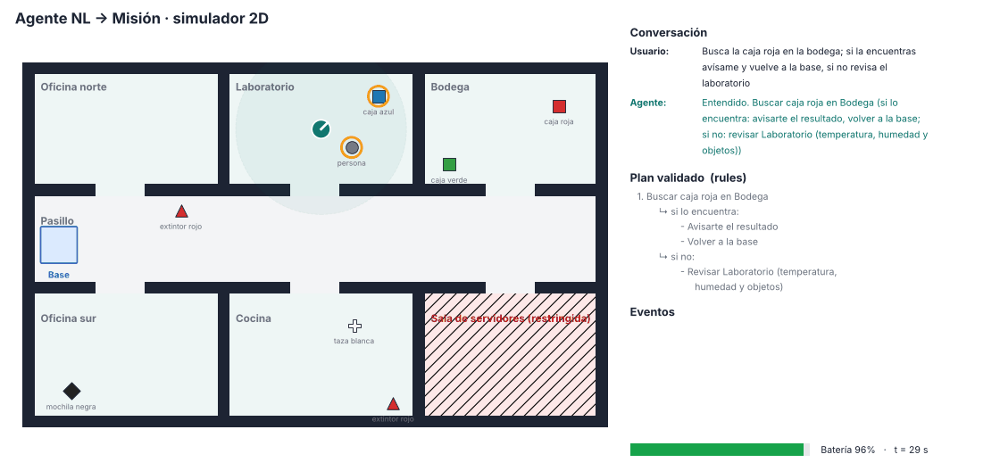

# nl2mission · Agente de lenguaje natural → misión robótica (MVP) EVENTO CLAUDE SDK AGENT BOGOTA

Le hablas al robot como le hablarías a una persona y el agente lo convierte en una misión
**estructurada, validada y ejecutable**:

> "Busca la caja roja en la bodega; si la encuentras avísame y vuelve a la base, si no revisa el laboratorio"

```json
[{"action": "find_object", "object_type": "caja", "object_color": "rojo", "target": "bodega",
  "then": [{"action": "say", "message": "{resultado}"}, {"action": "return_home"}],
  "else": [{"action": "inspect", "target": "laboratorio", "measure": "general"}]}]
```



La idea central del MVP: **el LLM propone, un validador determinista decide**. El modelo de
lenguaje nunca mueve el robot directamente.

```
usuario ─► Parser (Claude · Ollama · reglas) ─► Validador determinista ─┬─► Ejecutor ─► Backend (sim 2D | ROS2/Nav2/Gazebo)
              ▲                                                         ├─► Pregunta de aclaración
              └──────────────── respuesta del usuario ◄─────────────────┴─► Rechazo con motivo y alternativa
```

## Estado (noviembre 2026) · proyecto en pausa

- ✅ Agente, validador, simulador 2D, demo de 10 escenas, visor 3D (`viewer/visor3d.html`) y 18 tests.
- ✅ Integración ROS2 Jazzy: el agente se conecta, lee TF y envía metas a Nav2 (probado en Ubuntu 24.04 ARM, Parallels).
- ⏳ Pendiente: que el TurtleBot3 complete la navegación en Gazebo dentro de la VM. Nav2 acepta la meta, pero el robot
  no se mueve. Sospecha: rendimiento de la VM (Real Time Factor bajo con renderizado por software). Probar en Ubuntu nativo.
- ⏳ Pendiente: correr la ruta LLM real (`--parser anthropic` / `--parser ollama`); hoy solo está probada con un cliente simulado.

### Notas de la prueba en Gazebo (Parallels ARM)
- Usar el mismo middleware en todas las terminales: `export RMW_IMPLEMENTATION=rmw_fastrtps_cpp` (el sistema traía Zenoh sin router).
- Si Nav2 queda `inactive` (el `planner_server` no arrancó a tiempo), activar a mano:
  ```bash
  for n in controller_server smoother_server planner_server behavior_server velocity_smoother collision_monitor bt_navigator waypoint_follower; do
    s=$(ros2 lifecycle get /$n 2>&1); case "$s" in unconfigured*) ros2 lifecycle set /$n configure && ros2 lifecycle set /$n activate ;; inactive*) ros2 lifecycle set /$n activate ;; esac
  done
  ```
- Dar la pose con "2D Pose Estimate" en RViz y lanzar el agente con `--no-initial-pose`.

## Qué demuestra

| Capacidad | Ejemplo |
|---|---|
| Secuencias | "Ve al laboratorio y mide la temperatura y la humedad" |
| Condicionales | "…si la encuentras avísame, si no revisa el laboratorio" |
| Umbrales (control) | "si la sala de servidores pasa de 30 grados avísame" |
| Ambigüedad → pregunta | "Ve a la oficina" → "¿Oficina norte u Oficina sur?" |
| Lugar u objeto desconocido → pregunta | "Ve a la terraza", "busca a Juan" |
| Contexto conversacional | "busca un extintor **ahí**" |
| Imposibles → rechazo con alternativa | "Tráeme un café" (no tiene brazo) |
| Seguridad: zona restringida | Pide confirmación humana antes de entrar |
| Seguridad: batería | Rechaza misiones que dejarían al robot sin reserva |
| Robustez | errores de digitación ("laboratrio"), español e inglés básico |

## Estructura

```
nl2mission/
  world.py            modelo semántico (lugares, alias, objetos, colores) desde JSON
  schema.py           esquema JSON de la misión (también es el "tool" del LLM)
  parsers/llm.py      Claude (API de Anthropic) y Ollama (modelo local) con salida estructurada
  parsers/rules.py    parser offline (línea base, demos sin internet)
  validator.py        grounding + seguridad + batería
  agent.py            ciclo conversacional: aclaraciones, confirmaciones, contexto
  executor.py         ejecuta la misión sobre cualquier backend
  backends/sim2d.py   simulador 2D (A*, percepción con línea de vista, batería)
  backends/ros2_nav2.py  ROS2 + Nav2 (BasicNavigator), TF, tópicos de sensores
  render.py           GIF / MP4 de cada misión
config/world_lab.json mundo del simulador 2D
scripts/nl2mission_cli.py      consola interactiva (sim2d o ros2)
scripts/demo_presentacion.py   demo guionizada de 10 escenas + GIFs
scripts/construir_visor3d.py   genera viewer/visor3d.html (visor 3D autocontenido)
scripts/capturar_lugares.py    crear el mundo de Gazebo haciendo clic en RViz
tests/                         18 pruebas (pytest)
```

## 1. Prueba rápida (cualquier PC, sin ROS)

```bash
pip install numpy matplotlib pillow pytest     # en Ubuntu 24.04 agrega --break-system-packages o usa un venv
python3 -m pytest -q tests
python3 scripts/nl2mission_cli.py --gif-dir salida/          # conversa con el robot
python3 scripts/demo_presentacion.py --out demo_out --mp4    # demo completa para la presentación
```

## 2. Con un LLM de verdad (lo recomendado para la presentación)

**Claude** (mejor comprensión, requiere API key):
```bash
pip install anthropic
export ANTHROPIC_API_KEY=...
python3 scripts/nl2mission_cli.py --parser anthropic            # modelo por defecto: claude-sonnet-5-5
python3 scripts/demo_presentacion.py --parser anthropic --out demo_claude
```

**Ollama** (local, gratis, sin internet):
```bash
curl -fsSL https://ollama.com/install.sh | sh
ollama pull qwen2.5:7b
python3 scripts/nl2mission_cli.py --parser ollama --model qwen2.5:7b
```

El LLM recibe el mapa semántico, el estado del robot y el contexto de la conversación, y está
obligado a responder llamando a la herramienta `submit_mission` (JSON Schema). Luego pasa por el
mismo validador que el parser de reglas: si inventa un lugar, una acción o se pasa de batería, se
bloquea y el agente pregunta.

Comparar `--parser rules` contra `--parser anthropic` con frases libres es un buen experimento
para la presentación: las reglas fallan en cuanto cambias la forma de pedir las cosas; el LLM no.

## 3. Mini prueba en Gazebo (Ubuntu 24.04 + ROS2 Jazzy)

```bash
# 1) Nav2 + TurtleBot3 en Gazebo (Jazzy usa Gazebo Harmonic)
sudo apt install ros-jazzy-navigation2 ros-jazzy-nav2-bringup "ros-jazzy-nav2-minimal-tb*"
source /opt/ros/jazzy/setup.bash
ros2 launch nav2_bringup tb3_simulation_launch.py headless:=False

# 2) En otra terminal: crear el mapa semántico haciendo clic en RViz ("Publish Point")
source /opt/ros/jazzy/setup.bash
cd nl2mission
python3 scripts/capturar_lugares.py --out config/world_gazebo.json
#   captura › lugar base         (clic donde aparece el robot)
#   captura › lugar zona norte   (clic) ... repite para 4-6 lugares
#   captura › objeto caja rojo   (clic)  -> objetos para la percepción "oráculo"
#   captura › guardar
# Edita el JSON para agregar alias ("lab", "almacén"…) y valores de sensores.

# 3) Hablarle al robot
python3 scripts/nl2mission_cli.py --backend ros2 --world config/world_gazebo.json --parser ollama
```

- En Ubuntu 22.04 + Humble funciona igual (`ros-humble-*`; Humble usa Gazebo Classic y
  `turtlebot3_gazebo`, ver la guía "Getting Started" de Nav2).
- Si prefieres dar la pose inicial con "2D Pose Estimate" en RViz, usa `--no-initial-pose`.
- Tópicos: `/nl2mission/speech` y `/nl2mission/events` (salida), `/nl2mission/temperature`,
  `/nl2mission/humidity` y `/nl2mission/detections` (entrada, opcionales).

## Limitaciones honestas del MVP

- **Percepción:** en Gazebo es un "oráculo" (posiciones conocidas + rango). El siguiente paso es
  un nodo YOLO que publique en `/nl2mission/detections`; el agente no cambia.
- **Parser de reglas:** cubre los patrones de la demo, no el lenguaje libre. Es la línea base, no el producto.
- **Ruta LLM:** probada con un cliente simulado en los tests; hay que correrla con tu API key u Ollama.
- **Backend ROS2:** probado contra módulos ROS simulados (stubs). La prueba real en Gazebo es el paso 3.
- Condicionales de un solo nivel, sin bucles "hasta que", sin replanificación si Nav2 falla a mitad de camino.

## Hoja de ruta

1. Voz: Whisper (STT) + TTS → `/nl2mission/speech`.
2. Percepción real: YOLO + profundidad → detecciones en el frame `map`.
3. Memoria espacial: "¿dónde viste la caja?" a partir de las detecciones históricas.
4. Behavior Trees (BT.CPP / Nav2) como formato de salida en lugar de la lista de pasos.
5. Métricas para el paper: tasa de éxito, preguntas por misión y misiones inseguras bloqueadas,
   comparando reglas, LLM local y LLM en la nube sobre un set de 100 órdenes.
